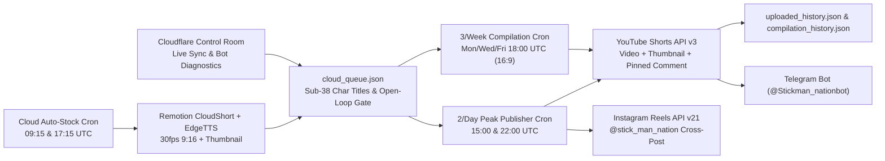

# StickNation Daily — Autonomous 3D Shorts & Long-Form Studio

[](https://github.com/Charansingaraju1/stickman-automation/actions/workflows/daily_shorts.yml)
[](https://github.com/Charansingaraju1/stickman-automation/actions/workflows/weekly_compilations.yml)
[](https://github.com/Charansingaraju1/stickman-automation/actions/workflows/cloud_auto_stock.yml)
[](https://github.com/Charansingaraju1/stickman-automation/actions/workflows/agents_pipeline.yml)
[](https://youtube.com/@StickNationDaily)
[](https://instagram.com/stick_man_nation)
[](https://sticknation-bot.sticknation.workers.dev)
[](agents/run_agents.py)

Zero-cost, cloud-native production pipeline that scripts, renders, audits, and publishes **open-loop 3D Stickman Shorts**, **Instagram Reels (`@stick_man_nation`)**, and **weekly `16:9` Watch-Hour compilations** for **[@StickNationDaily](https://youtube.com/@StickNationDaily)** on **GitHub Actions + Remotion + Cloudflare Workers** with **0% local laptop load**.

---

## System Architecture



---

## Automated Cloud Schedules (`$0/mo`)

| Workflow | Schedule (UTC) | Purpose |
| :--- | :--- | :--- |
| [`daily_shorts.yml`](.github/workflows/daily_shorts.yml) | `0 15,22 * * *` (`2/day` US Peak) | Publishes 1 Short per run on YouTube, cross-posts to Instagram Reels (when secret configured), commits history, alerts Telegram. |
| [`weekly_compilations.yml`](.github/workflows/weekly_compilations.yml) | `0 18 * * 1,3,5` (Mon/Wed/Fri) | Stitches Shorts into a `16:9` blurred dark-cinema compilation with chapter timestamps + `1280x720` split-duel thumbnail for `4,000` Watch Hours. |
| [`cloud_auto_stock.yml`](.github/workflows/cloud_auto_stock.yml) | `15 9,17 * * *` | Renders open-loop Remotion 3D Shorts + JPEG thumbnails in cloud until at least `6` Shorts sit ready on deck. |
| [`agents_pipeline.yml`](.github/workflows/agents_pipeline.yml) | `30 13 * * *` (7:00 PM IST Daily) | Runs the `$0` free-tier crew via GitHub Models (`openai/gpt-4o-mini`) and delivers C Assistant's evening brief. |
| [`render_short.yml`](.github/workflows/render_short.yml) | Manual (`workflow_dispatch`) | On-demand FFmpeg/EdgeTTS Short render in GitHub Actions. |

---

## 7-Agent `$0` Crew & Guardrails

Defined in [`agents/prompts.py`](agents/prompts.py) and enforced by [`agents/run_agents.py`](agents/run_agents.py):

| Agent | Role | Responsibility |
| :--- | :--- | :--- |
| `c_assistant` | Team Lead | Coordinates daily handoffs and sends the 7:00 PM IST Telegram briefing. |
| `script_agent` | Retention Writer | Builds open-loop 4–5 beat scripts (`<= 38`-char mobile titles, numbers, answer withheld until `0:14+`). |
| `editor` | Video & Audio Lead | Renders 9:16/16:9 Remotion visuals, EdgeTTS multi-voice fallback, `-14 LUFS` audio, and contrast thumbnails. |
| `publisher` | YPP & Upload Gatekeeper | Blocks duplicate titles, thin descriptions (`< 100` chars), and template spam; sets `containsSyntheticMedia`. |
| `social_manager` | Cross-Platform Growth | Syncs YouTube Shorts, `@stick_man_nation` Reels, pinned comments, tags, and chapter timestamps. |
| `watchdog` | `$0` Billing Guard | Hard-locks free endpoints/models (`BillingHaltError`) and alerts Telegram on any non-free or HTTP `402` trigger. |
| `security_agent` | Secret Auditor | Verifies `.gitignore` rules and scans tracked Python files (`audit_security()`) for leaked credentials. |

---

## Production Queue & Release History

### Ready on Deck (`cloud_queue.json`)

| # | ID | Title (`<= 38` Chars) | Runtime | Assets |
| :-: | :--- | :--- | :-: | :--- |
| 1 | `knuckle_cracking` | Why Knuckles Fail For 15 Mins? | `26.2s` | [`stickman_knuckle_cracking_viral.mp4`](videos/stickman_knuckle_cracking_viral.mp4) · [Thumb](videos/stickman_knuckle_cracking_thumbnail.jpg) |
| 2 | `hotel_kettle_danger` | Never Drink 1st Hotel Kettle Boil? | `20.4s` | [`stickman_hotel_kettle_viral.mp4`](videos/stickman_hotel_kettle_viral.mp4) · [Thumb](videos/stickman_hotel_kettle_thumbnail.jpg) |
| 3 | `watermelon_seed_myth` | What 1 Seed Does Inside In 24h? | `19.7s` | [`stickman_watermelon_seed_viral.mp4`](videos/stickman_watermelon_seed_viral.mp4) · [Thumb](videos/stickman_watermelon_seed_thumbnail.jpg) |
| 4 | `bleach_vinegar_gas` | Bleach + Vinegar: 10s Lung Risk? | `17.3s` | [`stickman_bleach_vinegar_viral.mp4`](videos/stickman_bleach_vinegar_viral.mp4) · [Thumb](videos/stickman_bleach_vinegar_thumbnail.jpg) |
| 5 | `nosebleed_tilt_mistake` | Nosebleed? Never Tilt Back 10m! | `17.1s` | [`stickman_nosebleed_tilt_viral.mp4`](videos/stickman_nosebleed_tilt_viral.mp4) · [Thumb](videos/stickman_nosebleed_tilt_thumbnail.jpg) |
| 6 | `stay_awake_72h` | 72 Hours Awake? 2s Blackout! | `18.8s` | [`stickman_stay_awake_viral.mp4`](videos/stickman_stay_awake_viral.mp4) · [Thumb](videos/stickman_stay_awake_thumbnail.jpg) |

*(Next cloud auto-stock topics queued in [`renderers/cloud_short_factory.py`](renderers/cloud_short_factory.py): `grease_fire_volcano`, `reaper_water_burn`, `superglue_cotton_fire`.)*

### Published on YouTube (`uploaded_history.json`)

1. `hangnail` — Why You Should NEVER Pull a Hangnail 😱🩸 `#shorts`
2. `holding_pee` — What Happens If You Hold Your Pee?! 🚽💀 `#shorts`
3. `swallowing_gum` — Does Swallowed Gum REALLY Stay For 7 Years?! 🍬😱 `#shorts`
4. `holding_sneeze` — What Actually Happens If You Hold in a Sneeze?! 🤧💀 `#shorts`
5. `pimple_danger_triangle` — Why You Should NEVER Pop It 🩸💀 `#shorts`
6. `ear_bug_tweezer_danger` — Why You Should NEVER Dig Out an Ear Bug 🪲😱 `#shorts`
7. `qtip_eardrum_danger` — Why You Should NEVER Clean Ears With Q-Tips 👂😱 `#shorts`
8. `fish_bone_bread_danger` — Why You Should NEVER Eat Bread for a Fish Bone 🦴😱 `#shorts`
9. `mentos_cola_danger` — Bro Thought It Was Just A Harmless Soda Trick… 🥤💀 `#shorts`

---

## Repository Structure

```text
stickman-automation/
├── .github/workflows/        # 2/day Shorts+IG, 3/wk 16:9 compilations, auto-stock, 7-agent brief
├── agents/                   # 7-agent prompts, YPP deterministic auditor, $0 billing & leak guards
├── renderers/                # Cloud Remotion factory, 16:9 Watch-Hour compiler & EdgeTTS builder
├── src/                      # Remotion CloudShort (9:16), CloudThumbnail & CloudLongThumbnail (16:9)
├── public/                   # 3D scene frames & SFX/audio assets served by Remotion
├── videos/                   # Rendered 9:16 MP4 Shorts & JPEG thumbnails ready for cloud publish
├── cloud_queue.json          # Active stocked queue synced to Control Room
├── uploaded_history.json     # Published YouTube Short IDs for deduplication
├── upload_to_youtube.py      # YouTube Data API v3 uploader, YPP validator, OAuth setup & alerts
└── upload_to_instagram.py    # Graph API v21.0 Instagram Reels uploader for @stick_man_nation
```

---

## CLI Reference

```bash
# Inspect queue state across published and ready-on-deck videos
python upload_to_youtube.py --status

# Simulate next YouTube upload & Instagram Reels post without publishing
python upload_to_youtube.py --dry-run
python upload_to_instagram.py --dry-run

# Verify all 7 agents, BillingGuard, SecurityAgent, and all CLOUD_PROFILES
python agents/run_agents.py --self-test

# Re-authorize local YouTube OAuth (upload + pinned comments)
python upload_to_youtube.py --auth

# Render & queue next unbuilt cloud Short (maintains 6-video cloud buffer)
python renderers/cloud_short_factory.py --next --min-ready 6 --queue

# Build 16:9 Watch-Hour compilation + 1280x720 thumbnail locally
python renderers/compile_longform.py
```

---

## Security & Secrets Isolation

* **GitHub Actions Secrets:** `YOUTUBE_TOKEN_JSON` and `YOUTUBE_CLIENT_SECRET_JSON` (plus optional `IG_ACCESS_TOKEN` for Instagram Reels) inject only into ephemeral `ubuntu-latest` runners; `agents_pipeline.yml` uses the scoped runner `GITHUB_TOKEN` (`models: read`).
* **Local Isolation:** [`.gitignore`](.gitignore) excludes `.env`, `token.json`, `client_secret.json`, build caches (`out/`), and runtime artifacts.
* **Control Room:** Live stats, queue sync, and bot health run on [sticknation-bot.sticknation.workers.dev](https://sticknation-bot.sticknation.workers.dev).
