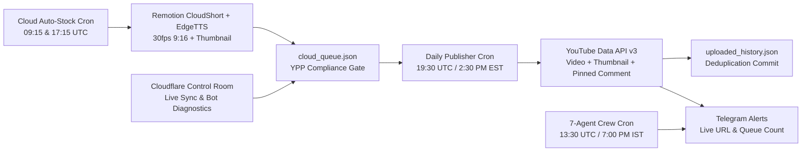

# StickNation Daily — Autonomous 3D Shorts Studio

[](https://github.com/Charansingaraju1/stickman-automation/actions/workflows/daily_shorts.yml)
[](https://github.com/Charansingaraju1/stickman-automation/actions/workflows/cloud_auto_stock.yml)
[](https://github.com/Charansingaraju1/stickman-automation/actions/workflows/agents_pipeline.yml)
[](https://youtube.com/@StickNationDaily)
[](https://instagram.com/stick_man_nation)
[](https://sticknation-bot.sticknation.workers.dev)
[](agents/run_agents.py)

Zero-cost, cloud-native production pipeline that scripts, renders, audits, and publishes **3D Dark-Cinema Stickman Shorts** for **[@StickNationDaily](https://youtube.com/@StickNationDaily)** on **GitHub Actions + Remotion + Cloudflare Workers** with **0% local laptop load**.

---

## System Architecture



---

## Automated Cloud Schedules

| Workflow | Schedule (UTC) | Purpose |
| :--- | :--- | :--- |
| [`daily_shorts.yml`](.github/workflows/daily_shorts.yml) | `30 19 * * *` (2:30 PM EST / 1:00 AM IST) | Publishes 1 validated Short/day, sets thumbnail, posts top comment, commits `uploaded_history.json`, alerts Telegram. |
| [`cloud_auto_stock.yml`](.github/workflows/cloud_auto_stock.yml) | `15 9,17 * * *` (2:45 PM & 10:45 PM IST) | Renders Remotion 3D Shorts + JPEG thumbnails in cloud until at least 3 queued Shorts sit ready on deck. |
| [`agents_pipeline.yml`](.github/workflows/agents_pipeline.yml) | `30 13 * * *` (7:00 PM IST Daily) | Runs the `$0` free-tier crew via GitHub Models (`openai/gpt-4o-mini`) and delivers C Assistant's evening brief. |
| [`render_short.yml`](.github/workflows/render_short.yml) | Manual (`workflow_dispatch`) | On-demand FFmpeg/EdgeTTS Short render in GitHub Actions. |

---

## 7-Agent `$0` Crew & Guardrails

Defined in [`agents/prompts.py`](agents/prompts.py) and orchestrated by [`agents/run_agents.py`](agents/run_agents.py):

| Agent | Role | Responsibility |
| :--- | :--- | :--- |
| `c_assistant` | Team Lead | Coordinates daily handoffs and sends the 7:00 PM IST Telegram summary. |
| `script_agent` | Comedy Writer | Builds 4–5 beat mistake-first scripts with Frame-0 deadpan hooks and tight loop endings. |
| `editor` | Video & Audio Lead | Renders 9:16 Remotion dark-cinema scenes, varied voices/palettes, `-14 LUFS` audio, and hybrid thumbnails. |
| `publisher` | YPP & Upload Gatekeeper | Blocks duplicate titles, short descriptions (`<100` chars), and repetitive templates; manages `containsSyntheticMedia`. |
| `social_manager` | Cross-Platform Growth | Manages YouTube metadata, pinned comments, tags, and `@stick_man_nation` readiness. |
| `watchdog` | `$0` Billing Guard | Enforces free-tier endpoints/models (`BillingHaltError`) and halts immediately on non-free/402 targets. |
| `security_agent` | Secret Auditor | Verifies `.gitignore` coverage and scans tracked Python modules for leaked credentials. |

---

## Production Queue & Release History

### Ready on Deck (`cloud_queue.json`)

| # | ID | Title | Runtime | Assets |
| :-: | :--- | :--- | :-: | :--- |
| 1 | `mentos_cola_danger` | Bro Thought It Was Just A Harmless Soda Trick… 🥤💀 `#shorts` | `19.0s` | [`stickman_mentos_cola_viral.mp4`](videos/stickman_mentos_cola_viral.mp4) · [Thumb](videos/stickman_mentos_cola_thumbnail.jpg) |
| 2 | `knuckle_cracking` | Bro Thought Cracking Knuckles Breaks Bones… 💀 `#shorts` | `21.2s` | [`stickman_knuckle_cracking_viral.mp4`](videos/stickman_knuckle_cracking_viral.mp4) · [Thumb](videos/stickman_knuckle_cracking_thumbnail.jpg) |
| 3 | `hotel_kettle_danger` | Bro Thought It Was Regular Tap Water In A Hotel Kettle 😱💀 `#shorts` | `18.3s` | [`stickman_hotel_kettle_viral.mp4`](videos/stickman_hotel_kettle_viral.mp4) · [Thumb](videos/stickman_hotel_kettle_thumbnail.jpg) |
| 4 | `watermelon_seed_myth` | Bro Accidentally Swallowed A Watermelon Seed… 🍉😱 `#shorts` | `19.8s` | [`stickman_watermelon_seed_viral.mp4`](videos/stickman_watermelon_seed_viral.mp4) · [Thumb](videos/stickman_watermelon_seed_thumbnail.jpg) |

### Published (`uploaded_history.json`)

1. `hangnail` — Why You Should NEVER Pull a Hangnail 😱🩸 `#shorts`
2. `holding_pee` — What Happens If You Hold Your Pee?! 🚽💀 `#shorts`
3. `swallowing_gum` — Does Swallowed Gum REALLY Stay For 7 Years?! 🍬😱 `#shorts`
4. `holding_sneeze` — What Actually Happens If You Hold in a Sneeze?! 🤧💀 `#shorts`
5. `pimple_danger_triangle` — Why You Should NEVER Pop It 🩸💀 `#shorts`
6. `ear_bug_tweezer_danger` — Why You Should NEVER Dig Out an Ear Bug 🪲😱 `#shorts`
7. `qtip_eardrum_danger` — Why You Should NEVER Clean Ears With Q-Tips 👂😱 `#shorts`
8. `fish_bone_bread_danger` — Why You Should NEVER Eat Bread for a Fish Bone 🦴😱 `#shorts`

---

## Repository Structure

```text
stickman-automation/
├── .github/workflows/        # Daily upload, cloud auto-stock, 7-agent crew, manual render
├── agents/                   # 7-agent prompts, YPP deterministic auditor, $0 billing & leak guards
├── renderers/                # Cloud Remotion factory (cloud_short_factory.py) & audio/FFmpeg builder
├── src/                      # Remotion compositions (CloudShort.tsx, CloudThumbnail.tsx, components/)
├── public/                   # 3D scene frames & SFX/audio assets served by Remotion
├── videos/                   # Stocked 9:16 MP4 Shorts & JPEG thumbnails queued for cloud publish
├── cloud_queue.json          # Active dynamically stocked upload queue
├── uploaded_history.json     # Published video IDs used for deduplication
└── upload_to_youtube.py      # YouTube Data API v3 uploader, YPP validator, OAuth setup & alerts
```

---

## CLI Reference

```bash
# Inspect merged VIRAL_QUEUE + cloud_queue.json status
python upload_to_youtube.py --status

# Run YPP compliance & next-upload simulation without calling YouTube
python upload_to_youtube.py --dry-run

# Verify all 7 agents, BillingGuard, SecurityAgent, and all CLOUD_PROFILES
python agents/run_agents.py --self-test

# Re-authorize local YouTube OAuth (upload + pinned comments)
python upload_to_youtube.py --auth

# Render & queue next unbuilt cloud Short (used by GitHub Actions)
python renderers/cloud_short_factory.py --next --min-ready 3 --queue
```

---

## Security & Secrets Isolation

* **GitHub Actions Secrets:** `YOUTUBE_TOKEN_JSON` and `YOUTUBE_CLIENT_SECRET_JSON` are injected only inside ephemeral `ubuntu-latest` runners during `daily_shorts.yml`; `agents_pipeline.yml` uses the scoped runner `GITHUB_TOKEN` (`models: read`).
* **Local Isolation:** [`.gitignore`](.gitignore) excludes `.env` (Meta/Instagram tokens), `token.json`, `client_secret.json`, build caches, and agent runtime outputs from version control.
* **Control Room:** Live pipeline status, YouTube metrics, and agent state are monitored at [sticknation-bot.sticknation.workers.dev](https://sticknation-bot.sticknation.workers.dev).
