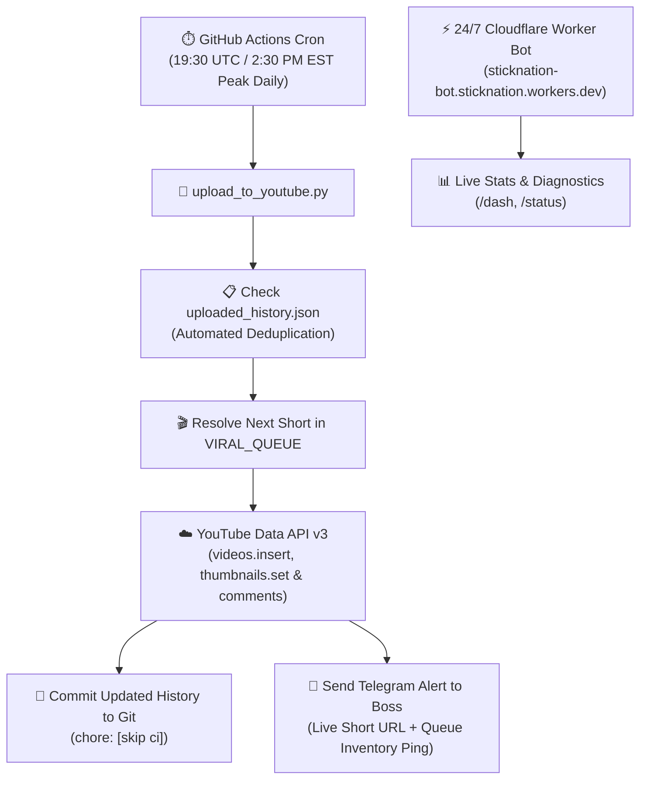

# 🚀 StickNation Daily — Automated 3D Shorts Pipeline

[](https://github.com/Charansingaraju1/stickman-automation/actions/workflows/daily_shorts.yml)
[](https://youtube.com/@StickNationDaily)
[](https://workers.cloudflare.com)
[](https://www.python.org/)

Autonomous cloud-native pipeline generating, packaging, and publishing high-retention 3D medical curiosity animations for **[@StickNationDaily](https://youtube.com/@StickNationDaily)** with **0% local laptop load**.

---

## 🏗️ System Architecture



---

## 📈 Audience & Algorithmic Calibration

All video structures, scripts, and metadata are calibrated directly from **YouTube Studio Analytics**:

| Dimension | Measured Channel Data | Tactical Implementation |
| :--- | :--- | :--- |
| **Audience Age** | **66% (35–44)** \| **34% (25–34)** | Adult clinical curiosity; zero juvenile slang (*no "Bro thought" / "L rizz"*). |
| **Screen Distribution** | **92.8% Mobile & Tablets** | Vertical center-middle captions (35%–60% safe zone); high-contrast rim lighting. |
| **Target Retention** | **>65% Stay Rate** \| **>80% APV** | Strict 27.0–27.5s runtimes; 0:03.5 sensory jolt; split-sentence loop handshake. |
| **SEO & Categorization** | **High-Intent Medical Clusters** | Entity-dense 2-sentence descriptions + authoritative `#shorts #medical #anatomy`. |

---

## 📋 Viral Production Queue

```bash
python upload_to_youtube.py --status
```

| # | ID | Title | Runtime | Status | Asset Files |
| :-: | :--- | :--- | :-: | :-: | :--- |
| 1 | `hangnail` | Why You Should NEVER Pull a Hangnail 😱🩸 | 31.2s | ✅ Published | `stickman_hangnail_paronychia.mp4` |
| 2 | `holding_pee` | What Happens If You Hold Your Pee?! 🚽💀 | 41.0s | ✅ Published | `stickman_holding_pee_viral.mp4` |
| 3 | `swallowing_gum` | Does Swallowed Gum REALLY Stay For 7 Years?! 🍬😱 | 58.0s | ✅ Published | `stickman_swallowing_gum_viral.mp4` |
| 4 | `holding_sneeze` | What Actually Happens If You Hold in a Sneeze?! 🤧💀 | 29.8s | ✅ Published | `stickman_holding_sneeze_viral.mp4` |
| 5 | `pimple_danger_triangle` | Why You Should NEVER Pop It 🩸💀 | 27.5s | ✅ Published | `stickman_pimple_danger_viral.mp4`<br>`stickman_pimple_danger_thumbnail.jpg` |
| 6 | `ear_bug_tweezer_danger` | Why You Should NEVER Dig Out an Ear Bug 🪲😱 | 26.6s | ✅ Published | `stickman_ear_bug_viral.mp4`<br>`stickman_ear_bug_thumbnail.jpg` |
| 7 | `qtip_eardrum_danger` | Why You Should NEVER Clean Ears With Q-Tips 👂😱 | 30.1s | ✅ Published | `stickman_qtip_viral.mp4`<br>`stickman_qtip_thumbnail.jpg` |
| 8 | `fish_bone_bread_danger` | Why You Should NEVER Eat Bread for a Fish Bone 🦴😱 | 29.1s | ✅ Published | `stickman_fish_bone_viral.mp4`<br>`stickman_fish_bone_thumbnail.jpg` |
| 9 | `splinter_tweezers_danger` | Why You Should NEVER Pull a Splinter With Tweezers 🪵🩸 | 31.5s | 🟡 **Next Up (Tonight 2:30 PM EST)** | `stickman_splinter_viral.mp4`<br>`stickman_splinter_thumbnail.jpg` |
| 10 | `superglue_eyelids_danger` | Why You Should NEVER Rip Open Superglued Eyelids 👁️😱 | 30.8s | 🟡 **Ready on Deck (Tomorrow)** | `stickman_superglue_eyes_viral.mp4`<br>`stickman_superglue_eyes_thumbnail.jpg` |

---

## 🛠️ CLI Commands & Local Tooling

Inspect and simulate the pipeline from your terminal:

```bash
# 1. View current queue state and missing assets
python upload_to_youtube.py --status

# 2. Simulate next upload without touching YouTube API
python upload_to_youtube.py --dry-run

# 3. Publish next video in queue (requires credentials)
python upload_to_youtube.py
```

---

## 🔒 Security & Secrets Isolation

All authentication relies on GitHub Actions Repository Secrets:
* `YOUTUBE_TOKEN_JSON`: Decoded during cloud runner execution; never committed.
* `YOUTUBE_CLIENT_SECRET_JSON`: Client secrets isolated from Git tracking.
* Sensitive patterns (`token.json`, `client_secret.json`, `.env`) are strictly enforced via `.gitignore`.
