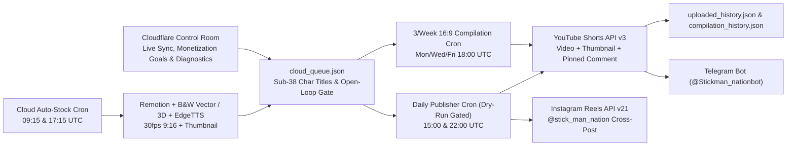

# StickNation Daily — Autonomous AI Stickman YouTube Studio

[](https://github.com/Charansingaraju1/stickman-automation/actions/workflows/daily_shorts.yml)
[](https://github.com/Charansingaraju1/stickman-automation/actions/workflows/weekly_compilations.yml)
[](https://github.com/Charansingaraju1/stickman-automation/actions/workflows/cloud_auto_stock.yml)
[](https://github.com/Charansingaraju1/stickman-automation/actions/workflows/agents_pipeline.yml)
[](https://youtube.com/@StickNationDaily)
[](https://instagram.com/stick_man_nation)
[](https://sticknation-bot.sticknation.workers.dev)
[](agents/run_agents.py)

Zero-cost (`$0.00`), cloud-native Autonomous AI Stickman YouTube Studio targeting **United States** audiences for **[@StickNationDaily](https://youtube.com/@StickNationDaily)** and **[@stick_man_nation](https://instagram.com/stick_man_nation)** using **GitHub Actions + Remotion + FFmpeg + EdgeTTS + Cloudflare Workers**.

---

## System Architecture



---

## What The 5 Core Agents Do (+ 2 Automated Guards)

Defined in [`agents/prompts.py`](agents/prompts.py), enforced by [`agents/run_agents.py`](agents/run_agents.py), and extended by [`agents/studio_engine.py`](agents/studio_engine.py):

### 5 Core Production Crew Agents

| # | Agent Key | Role | What It Does |
|---:|---|---|---|
| 1 | `c_assistant` | **Team Lead & Coordinator** | Routes daily handoffs from `script_agent` -> `editor` -> `publisher` -> `social_manager`, formats the 7:00 PM IST Telegram briefing, and enforces human approval before spend or publish. |
| 2 | `script_agent` | **Retention Scriptwriter** | Builds 15–30s US-English open-loop scripts (`<= 38`-char mobile titles, immediate personal stakes in frame 0, reveal held until `0:13+`, zero medical jargon, seamless mid-clause loop). |
| 3 | `editor` | **Video, Vector & Audio Lead** | Renders `1080x1920` Remotion animations (`ZackStickmanShort` B&W + selective signal color vector scenes and `CloudShort` 3D scenes), `16:9` compilations, EdgeTTS narration, `-14 LUFS` audio, safe-zone captions, and contrast thumbnails. |
| 4 | `publisher` | **YPP & Upload Gatekeeper** | Runs `validate_ypp_compliance()` to block duplicate titles, repetitive `Why You Should NEVER...` patterns, and thin descriptions (`< 100` chars); sets `containsSyntheticMedia`; runs `upload_to_youtube.py` cleanly during US peak slots. |
| 5 | `social_manager` | **Cross-Platform Growth & Analytics** | Syncs live YouTube Data API / Analytics feedback (`studio_engine.py --analytics`), cross-posts Instagram Reels (`upload_to_instagram.py`), manages pinned comments, and feeds winning hooks back into research. |

### 2 Automated Safety & Cost Guardrail Agents

| # | Agent Key | Role | What It Does |
|---:|---|---|---|
| 6 | `watchdog` | **`$0` Billing Guard** | Hard-locks inference to free GitHub Models (`openai/gpt-4o-mini` at `models.github.ai`) and raises `BillingHaltError` with an instant Telegram alarm if any non-free model/endpoint or HTTP `402` quota risk appears. |
| 7 | `security_agent` | **Secret & Hygiene Auditor** | Verifies `.gitignore` coverage (`.env`, `token.json`, `client_secret.json`) and scans `.py`, `.ts`, `.tsx`, `.yml`, `.js`, `.md`, and `.mjs` files via `audit_security()` so credentials never leak publicly. |

---

## Autonomous Studio Engineering Upgrade

- **Superpowers & Workspace Skills (`.agents/skills/`):** **45 validated `SKILL.md` skills** combining **10** `obra/superpowers` engineering skills, **4** `mattpocock/skills` (`domain-modeling`, `grilling`, `grill-with-docs`, `improve-codebase-architecture`), **18** consolidated Stickman Studio domain skills, and **13** Remotion skills.
- **Safety Gate & Workspace Charter:** Root rules in [`AGENTS.md`](AGENTS.md), **18** logical specialist roles in [`.agents/roles/STUDIO_TEAM.md`](.agents/roles/STUDIO_TEAM.md), pre-tool destructive-command hook in [`.agents/hooks/validate-tool-call.mjs`](.agents/hooks/validate-tool-call.mjs), and **13** persistent ledgers in [`memory/`](memory/PROGRESS.md).
- **B&W Vector Stickman Composition:** New minimalist B&W + selective signal-color Remotion composition [`src/ZackStickmanShort.tsx`](src/ZackStickmanShort.tsx), physics stages in [`src/components/StickmanPhysicsStage.tsx`](src/components/StickmanPhysicsStage.tsx), and expanded poses/expressions in [`src/components/Stickman.tsx`](src/components/Stickman.tsx).
- **Studio Engine (`agents/studio_engine.py`):** 100-point weighted topic scorer generating 30 ranked concepts (`--research`), storyboard + Flow continuity validator, FFprobe/silencedetect QC gate (`--qc`), and zero-fabrication YouTube Analytics API v2 reader (`--analytics`).
- **CI Cron Safety Gates:** [`daily_shorts.yml`](.github/workflows/daily_shorts.yml) and [`weekly_compilations.yml`](.github/workflows/weekly_compilations.yml) default scheduled runs to `--dry-run` unless `workflow_dispatch` is triggered or GitHub repo variable `AUTO_PUBLISH_ENABLED == 'true'` is enabled.

---

## Automated Cloud Schedules (`$0/mo`)

| Workflow | Schedule (UTC) | Purpose |
| :--- | :--- | :--- |
| [`daily_shorts.yml`](.github/workflows/daily_shorts.yml) | `0 15,22 * * *` | Simulates `--dry-run` on schedule unless `AUTO_PUBLISH_ENABLED == 'true'`; uploads next YouTube Short + Instagram Reel, commits history, alerts Telegram. |
| [`weekly_compilations.yml`](.github/workflows/weekly_compilations.yml) | `0 18 * * 1,3,5` | Builds `16:9` blurred dark-cinema Watch-Hour compilation (`compile_longform.py --dry-run` on cron unless `AUTO_PUBLISH_ENABLED == 'true'`). |
| [`cloud_auto_stock.yml`](.github/workflows/cloud_auto_stock.yml) | `15 9,17 * * *` | Maintains at least `6` ready-to-publish Remotion Shorts + thumbnails in `cloud_queue.json`. |
| [`agents_pipeline.yml`](.github/workflows/agents_pipeline.yml) | `30 13 * * *` | Runs `agents/run_agents.py --daily-brief` via free GitHub Models (`openai/gpt-4o-mini`) and dispatches Telegram brief. |
| [`render_short.yml`](.github/workflows/render_short.yml) | Manual (`workflow_dispatch`) | On-demand FFmpeg/EdgeTTS Short render in GitHub Actions. |

---

## Repository Structure

```text
stickman-automation/
├── .agents/                  # 45 validated workspace SKILL.md files, STUDIO_TEAM.md (18 roles), safety hook
├── .github/workflows/        # Daily Shorts+IG, weekly 16:9 compilations, auto-stock, agent brief, manual render
├── agents/                   # 7-agent prompts, deterministic YPP & secret auditor, studio_engine.py
├── cloudflare_worker/        # Control Room dashboard + Telegram webhook Worker (secrets via Cloudflare env)
├── memory/                   # 13 persistent markdown & JSON ledgers (PROJECT, PROGRESS, CHARACTER_BIBLE, etc.)
├── renderers/                # Cloud Remotion factory, 16:9 Watch-Hour compiler & EdgeTTS builder
├── src/                      # ZackStickmanShort (B&W vector), CloudShort (3D), Thumbnails & Physics Stages
├── tests/                    # Unit test suite (unittest discover -s tests)
├── videos/                   # Rendered 9:16 MP4 Shorts & JPEG thumbnails ready for cloud publish
├── AGENTS.md                 # Root workspace instructions & $0 engineering guardrails
├── cloud_queue.json          # Active stocked queue
├── uploaded_history.json     # Published YouTube Short IDs for deduplication
├── upload_to_youtube.py      # YouTube Data API v3 uploader, YPP validator, OAuth setup & Telegram alerts
└── upload_to_instagram.py    # Graph API v21.0 Instagram Reels uploader for @stick_man_nation
```

---

## CLI Reference

```bash
# Run Studio unit tests, TypeScript typecheck & 7-agent self-test
python -m unittest discover -s tests -v
npx tsc --noEmit
python agents/run_agents.py --self-test

# Generate 30 ranked concepts, run video QC gate, or query real YouTube Analytics
python agents/studio_engine.py --research
python agents/studio_engine.py --qc videos/stickman_knuckle_cracking_viral.mp4
python agents/studio_engine.py --analytics --days 7

# Simulate uploads & compilations safely without publishing
python upload_to_youtube.py --status
python upload_to_youtube.py --dry-run
python upload_to_instagram.py --dry-run
python renderers/compile_longform.py --dry-run

# Re-authorize local YouTube OAuth (upload + force-ssl + youtube.readonly + yt-analytics.readonly)
python upload_to_youtube.py --auth
```

---

## Security & Secrets Isolation

* **GitHub Actions Secrets:** Store `TELEGRAM_BOT_TOKEN`, `TELEGRAM_CHAT_ID`, `YOUTUBE_TOKEN_JSON`, `YOUTUBE_CLIENT_SECRET_JSON`, and `IG_ACCESS_TOKEN` in **GitHub Repository Secrets** (plus optional variable `AUTO_PUBLISH_ENABLED=true` when ready for scheduled auto-publishing).
* **Cloudflare Worker Secrets:** Store `BOT_TOKEN` and `GH_TOKEN` in **Cloudflare Worker Secrets** (`wrangler secret put BOT_TOKEN`), never hardcoded in `cloudflare_worker/worker.js`.
* **Local Isolation:** [`.gitignore`](.gitignore) excludes `.env`, `token.json`, `client_secret.json`, build caches (`out/`), and runtime artifacts.
